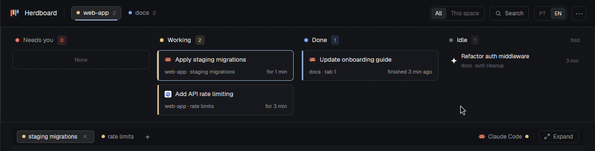
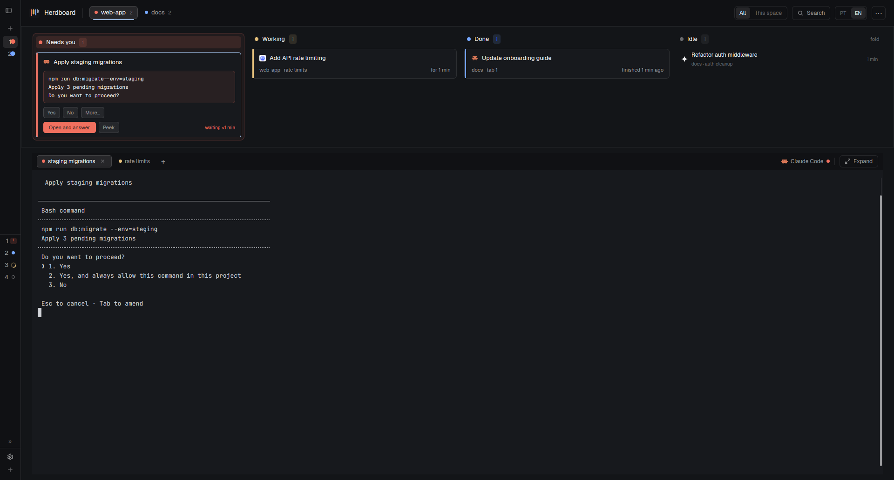

<p align="center"></p>

<h1 align="center">Herdboard</h1>

<p align="center">A kanban board for your coding agents in <a href="https://herdr.dev">Herdr</a>.<br>See which one needs you, and what it is asking, at a glance.</p>

<p align="center">
  
  
  
  
</p>

<p align="center"><b>English</b> · <a href="README.pt-BR.md">Português (Brasil)</a></p>

<p align="center"></p>

<p align="center"><sub>Demo data. An agent asks for permission: its card moves to <b>Needs you</b> with the question; once answered, it goes back to <b>Working</b>.</sub></p>

## Install

```sh
git clone https://github.com/TJbarros/herdboard.git
cd herdboard
scripts/install.sh            # on WSL it finds the Windows Herdr home
```

Then in Herdr: **Settings › Look › Layout › Herdboard**, or
`herdr-app do layout.switch --name herdboard`. The script only copies files and adds
the `layout:herdboard` section to `keys.json` (with a backup) when it isn't there.

Free and open source (Apache-2.0) · runs inside the Herdr app · tested with
herdr-app 0.1.13.

## Why

With several agents running across projects, the slow part is finding the one that
stopped to ask you something. Herdboard puts every agent of every space on one board
by status, shows a blocked agent's question on its card, and opens new tabs in the
project folder you pick.

## Herdboard and Herdr's default layout

| | Default layout | Herdboard |
| --- | --- | --- |
| Agents | a list in the sidebar | kanban columns by status, every space |
| What a blocked agent asks | open its terminal to read it | shown on its card |
| New tab folder | the focused terminal's | the active tab's, or one you pick |
| Language | English | English or Portuguese |

## Features

- **Needs you, answered from the board**: the question, *Open and answer*, *Peek*.
- **Cards that say what's going on**: task title, space · tab · branch, time in status.
- **"stuck?"** on an agent working for more than 30 minutes.
- **Peek, Pin and Put away** when you hover a card.
- **New tabs in the right folder**, with a folder picker.
- **One-line header** with every space, an All / This space filter and search.
- **Expand** the terminals to the whole window, and back.
- **Follows your Herdr theme**, light or dark; responsive; English / Portuguese.



**[Full guide →](docs/guide.md)** using it step by step (with screenshots), keys,
FAQ, update and uninstall.

## Contributing

Bug reports and ideas are welcome: see [CONTRIBUTING](CONTRIBUTING.md). Changes are
listed in the [CHANGELOG](CHANGELOG.md).

## License

Apache License 2.0. Derived from the `board` example in
[herdr-layout-examples](https://github.com/herdrdev/herdr-layout-examples) and from
mods shipped with Herdr; see [NOTICE](NOTICE). Not affiliated with the Herdr project.
