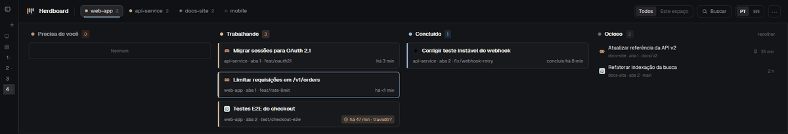
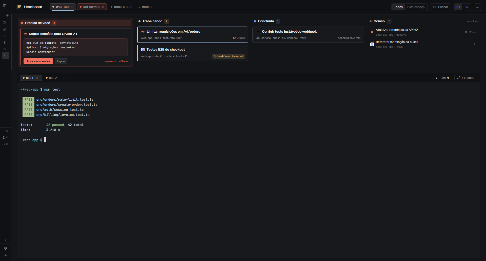

<p align="center"></p>

<h1 align="center">Herdboard</h1>

<p align="center">Um quadro kanban dos seus agentes de código no <a href="https://herdr.dev">Herdr</a>.<br>Veja qual precisa de você, e o que ele está perguntando, num relance.</p>

<p align="center">
  
  
  
  
</p>

<p align="center"><a href="README.md">English</a> · <b>Português (Brasil)</b></p>

<p align="center"></p>

<p align="center"><sub>Dados de exemplo no Herdr. Um pedido de permissão leva o agente a <b>Precisa de você</b>, com <b>Sim / Não / Mais…</b> no card. O clique em <b>Sim</b> ali o devolve a <b>Trabalhando</b>.</sub></p>

## Instalação

### Pelo seu agente do Herdr

O Herdboard está na [galeria do herdr.dev](https://herdr.dev/layouts). Cole num agente
rodando no Herdr a linha que o card dele mostra:

```
Read ~/.config/herdr-app/AGENTS.md, then add this layout: https://github.com/TJbarros/herdboard/tree/main
```

O agente lê todos os arquivos antes de adicionar o layout. O seu layout atual continua
como está.

### Pelo script

```sh
git clone https://github.com/TJbarros/herdboard.git
cd herdboard
scripts/install.sh
```

O `scripts/install.sh` copia o Herdboard para a pasta do Herdr: rodando no WSL, para a
do Windows (`C:\Users\<você>\.config\herdr-app`); rodando em qualquer outro lugar,
para `~/.config/herdr-app`, a pasta padrão do Herdr. Defina `HERDR_APP_HOME` para usar
outra pasta. Ele só copia arquivos e adiciona a seção `layout:herdboard` ao
`keys.json` (com backup) quando ela ainda não existe; essa etapa precisa do Python
3.7 ou mais recente, e sem ele o script avisa para você adicionar a seção
manualmente. É um script de shell POSIX (`sh`); no Windows, foi testado pelo WSL e
pelo Git Bash.

Para ver antes o que ele faria, rode `scripts/install.sh --dry-run`: ele mostra a pasta
do Herdr que encontrou, cada arquivo que copiaria (**new**, novo; **overwrite**,
sobrescreve; **unchanged**, igual) e o que aconteceria com o `keys.json`, sem mudar nada.

Depois, no Herdr: **Settings › Look › Layout › herdboard**, ou
`herdr-app do layout.switch --name herdboard`.

Gratuito e de código aberto (Apache-2.0) · roda dentro do app Herdr · testado no
Windows com o herdr-app 0.1.13.

## Por quê

Com vários agentes rodando em projetos diferentes, o que mais toma tempo é achar
aquele que parou para perguntar algo. O Herdboard põe todos os agentes de todos os
espaços num quadro por status, mostra a pergunta do agente bloqueado no próprio card
e abre novas abas na pasta de projeto que você escolher.

## Herdboard e o layout padrão do Herdr

| | Layout padrão | Herdboard |
| --- | --- | --- |
| Agentes | uma lista na barra lateral | colunas kanban por status, de todos os espaços |
| O que o agente bloqueado pergunta | abrir o terminal para ler | aparece no card dele |
| Pasta da nova aba | a do terminal em foco | a da aba ativa, ou a que você escolher |
| Idioma | inglês | inglês ou português |

## Recursos

- **"Precisa de você", respondido pelo quadro**: a pergunta, *Abrir e responder*, *Espiar*,
  e *Sim* / *Não* nas permissões do Claude Code, na tela de confiança de pasta reconhecida
  e no [diálogo verificado de comando local do Codex](docs/guide.pt-BR.md).
- **Cards que dizem o que está acontecendo**: título da tarefa, espaço · aba · branch,
  tempo no status e **Fazendo agora** em Trabalhando, com atividade recente reconhecida
  na tela ou estado neutro indisponível. [Formatos e limites verificados](docs/issue-25-verification.pt-BR.md).
- **Total do worktree** nos cards e nas entradas Ociosas: arquivos pendentes no Git
  da pasta atual de cada terminal, inclusive remoto, com estado indisponível separado.
- **Nome da máquina nos cards** quando há espaços remotos, com identificação Local
  e nas entradas compactas de Ocioso; origem indisponível aparece explicitamente.
- **"travado?"** num agente trabalhando há mais de 30 minutos.
- **Espiar, Fixar e Guardar** ao passar o mouse num card.
- **Novas abas na pasta certa**, com escolha de pasta.
- **Cabeçalho em uma linha** com todos os espaços, filtro Todos / Este espaço e busca.
- **Expandir** os terminais para a janela toda, e voltar.
- **Segue o tema do seu Herdr**, claro ou escuro; responsivo; inglês / português.



**[Guia completo →](docs/guide.pt-BR.md)** como usar passo a passo (com prints),
atalhos, perguntas frequentes, atualizar e desinstalar.

## Como contribuir

Relatos de problemas e ideias são bem-vindos: veja o [CONTRIBUTING](CONTRIBUTING.md).
As mudanças ficam no [CHANGELOG](CHANGELOG.md).

## Licença

Apache License 2.0. Derivado do exemplo `board` de
[herdr-layout-examples](https://github.com/herdrdev/herdr-layout-examples) e de mods
que acompanham o Herdr; veja o [NOTICE](NOTICE). Sem vínculo com o projeto Herdr.
