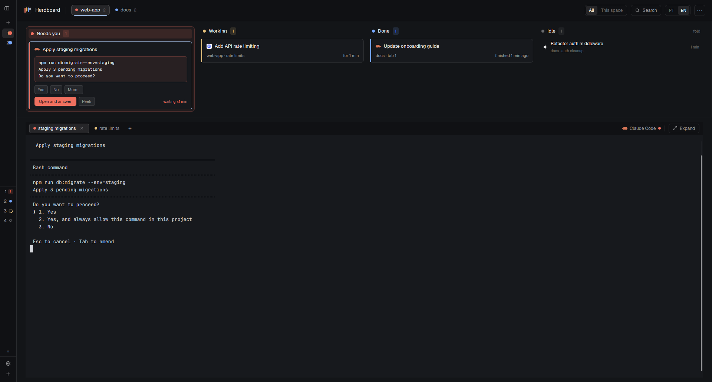

# Herdboard

A kanban board for your coding agents in Herdr. See which one needs you, and what it
is asking, at a glance: every agent of every space in four columns (Needs you,
Working, Done, Idle), above the live terminals of the active tab. Follows your Herdr
theme; English and Portuguese.

## What you see

Left to right: Herdr's own sidebar folded to its 44px icon rail, then the board
column, top to bottom:

1. **Header**, 56px, `chrome` background, one line: Herdboard logo (22px,
   `mods/herdboard/logo.svg`) and "Herdboard" (14px semibold); a 1px divider; the space
   strip (every space as a 28px pill: status dot or hollow ring when it has no
   agents, name 13px, agent count; the active one `selected` with a 2px `accent`
   underline; a blocked one tinted `blocked` at 12%), scrolling sideways; the
   All | This space segment; Search (icon + label); a PT | EN segment; a 30px ⋯
   button.
2. **Board**, height = its tallest column (140–360px), `canvas`, 1px `border`
   frame. Four equal columns, 16px gaps (10 below 1100px). Column header 26px:
   status dot, label 13px semibold, count chip (status color at 14%). Cards 64px,
   `background`, 7px corners, 3px status stripe: program icon + task title (13px
   semibold), then space · tab · branch and the age (11px `muted`). Blocked cards
   are taller: the question in a mono box tinted `blocked`, then, for a permission
   dialog, *Yes*, *No* and, when there are other options, *More…* (24px outlined
   buttons, their own row), then *Open and
   answer* (solid `blocked`) and *Peek*. Idle agents are 44px rows (icon, task over where,
   age). Empty columns: a 40px outlined "None".
3. **Workspace**, the rest, padding 12/24: a 36px `chrome` rail (tabs as 26px chips
   with status dot, × on the active/hovered one, a + after them; on the right the
   shown program's icon, name and status dot, and Expand), then the active tab's
   panes (`background`, 7px corners, 12px gaps; a pane header only when split).

## How it behaves

| Status | Column | Color |
| --- | --- | --- |
| blocked | Needs you (column gets a 6% tint and border) | theme `blocked` |
| working | Working ("stuck?" chip past 30 min) | theme `working` |
| done | Done | theme `done` |
| idle | Idle (compact rows, foldable) | theme `idle` |

- Cards: click focuses the agent (`agent.focus`); hover shows Peek
  (`terminal.peek`), Pin / Unpin (`terminal.pin`, pinned first in the column) and
  Put away (`tab.settle`; settled tabs leave the board).
- Task title: the terminal title without spinner glyphs (program names and bare
  addresses like `t2` don't count); the last one seen is kept in shared
  `herdboard.titles` and shown as "Last: …" when the agent has none.
- Age: Herdr's per-tab `working_since` / `changed_at` when the agent is alone in
  its tab, else the time the board first saw the status; refreshed every 30s.
- Blocked question: on each new blocked spell (address + `seq`), `hc read <t>
  --lines 0`; the last line ending in "?" and up to two before it, frames dropped,
  separator lines dropped (lines of horizontal glyphs only:
  `─ ━ ┄ ┅ ┈ ┉ ╌ ╍ ═ ╴ ╶ ╸ ╺ ╼ ╾ - _ ▔ ▁`, so Claude Code's dashed `╌` rows go and
  the command shows), tail kept (≤180 chars). No "?": "Open the terminal to see
  what the agent is asking." Parsed by `mods/herdboard/ask.js` (pure; `node --test`
  runs `tests/ask.test.js`). The same parse gives the request's `id`: the dialog's
  raw lines (nothing collapsed, trimmed or dropped: a no-break space ending a line
  counts) from the solid rule that opens it through the last option's continuation,
  the `❯` cursor
  (after the box's `│` in a boxed dialog) blanked on the option lines after the
  question only (the request above it stays byte for byte: a heredoc's `> 1. x` line
  is not a cursor); the screen above the dialog is left out (it blinks Claude Code's
  `●` tool line). The opening rule starts at column 0 (`───` or a box's `╭───╮`),
  which command lines can't (indented, or `│` in a box). Any doubt about the shape
  (no rule, a dashed `╌` line above it, other than 0 or 2 dashed lines between it and
  the question): no `id`, and no Yes / No.
  A read that misses (no "?", or, where Yes / No may show, no `id` or no exact
  Yes / No pair) is read again after `RETRY_MS` = 500 ms, then 1500 ms: at most 2
  more reads, `cx.sleep` in the same task, only while the spell lasts (checked
  before and after each wait). Only the last read of the spell is kept.
- Yes / No: the same read also collects the numbered options below the question
  (`❯ 1. Yes` … `4. No`, numbered 1, 2, 3… in order). Immediately following lines
  aligned to an option's text column join its text with one space; blank lines and
  the "Esc to cancel" footer never join. Buttons
  only for a Claude Code agent (`app` "claude-code"), when one option's text is
  exactly "Yes" and one's exactly "No" (once each, digits 1–9), and the agent's
  `report.kind` (from `terminals()`) is `permission`.
  Mapped by text, never by position. Tooltip: the option's number and text. Click:
  answers only the read its card was drawn from (that object still cached, same
  `address#seq`); drop the cached options (buttons faded and inert until status or
  `seq` changes), check the agent is still `blocked` with the same `address#seq`,
  read the screen again and require the same request `id`, then `hc keys <t> <digit>`
  (no `enter`). Any mismatch: type nothing, forget the read, so the card reads again.
  A screen read is kept only while its `address#seq` is still the agent's current
  one, and never over a kept read of that spell (reads overlap and finish in any
  order). A kept read is dropped when its spell ends, not when its card is hidden
  (This space filter, put-away tab), so an answered request stays answered.
  `tests/answer.test.js` drives this path in the real `main.js`, with the Herdr
  runtime stood in by `tests/runtime/`.
- More… (*Mais…*): only beside Yes / No, only when other options have one-key
  digits (1–9). Lists those options in screen order, excluding the Yes / No pair;
  the agent's own text is truncated in a row with its full text in a tooltip.
  A controlled `gpui-base` `Popover`, anchored `bottom_left`, holds its open state
  in the board copy as `address#seq`; its content belongs to that render, so it can
  use the cached ask and the same `answer(a, ask, n, cx)` guard. No popup copy of the
  mod. Every answer disables all three controls. The menu closes after a choice,
  on Escape, on an outside press, when the spell changes or the card leaves Needs
  you (including when hidden by a filter). The menu is layered above the window:
  More… stays in the Yes / No row and adds nothing to `blockedHeight`.
- A blocked card's waiting time uses the space left beside Open and answer and
  Peek, truncating with its full text in a tooltip when the column is narrow.
- Workspace trust is a separate startup source, approved for issue #3. Only a
  terminal in a registered pane, running a foreground `claude` / `claude.exe` with
  matching executable name, `state: live`, `screen: exact`, `reported: false` and
  no status/report qualifies for discovery. Its lifecycle key includes address,
  terminal creation time, terminal PID, foreground PID and foreground cwd. The
  screen must match the complete captured Claude Code 2.1.319 trust dialog, and
  its displayed folder must equal that cwd. The heading, folder, question,
  explanation, options and confirmation footer may wrap across terminal lines.
  Recognition consumes the complete known heading before locating the folder.
  Only the footer lines after
  the two options are joined for comparison with the complete known footer.
  Recognition locates the complete known prose before selecting the following
  `Security guide` marker; that same text can be a wrapped folder chunk. It
  matches the preceding folder chunks against the known cwd in order. Only
  at a path wrap may spaces be restored from the cwd; characters and spacing
  inside each chunk must match exactly. This distinguishes word wraps from
  mid-name breaks. Discovery and answer validation both supply that cwd to
  `parseAsk(screen, cwd)`. The guarded id keeps all raw lines unchanged. No OSC report is
  invented. The card's
  `blocked` is a presentation state belonging to this explicit source.
  The board polls eligible terminals about once a second (initial misses retain
  the existing bounded retries); other mod roles never fetch. Unknown screens
  stay off the board. Only recognised lifecycle keys are shared with the header
  for its counts and space indicator. An ended source drops its cache.
  Waiting time is observed per startup lifecycle, independent of the tab's
  earlier state-change timestamp; a new lifecycle starts a new clock even when
  the terminal address and presentation status stay the same between polls.
  First recognition brings its current tab back with `tab.unsettle` if put away,
  without changing focus. Recognition is remembered across polls and temporarily
  missing screens, separately from the read cache that answer validation can
  invalidate, so the same lifecycle does not undo a later Put away. Recognition
  is dropped when that lifecycle ends.
  Cursor options carry indices instead of digit shortcuts. Yes maps only to
  `Yes, I trust this folder`, No only to `No, exit`. Its id includes every raw line
  from the opening rule through the confirmation footer, including the selected
  row. A click validates the cached object, lifecycle and eligibility around each
  await, including fresh `hc get` calls before and after the screen read; then one
  `hc keys` sends `targetIndex - selectedIndex` arrows followed by Enter. Any
  mismatch sends nothing. Polls preserve the sent latch until the source ends,
  including across filters or a temporarily missing screen. Tooltips name the
  actual choice, with no invented option number. Numbered fingerprints and digit
  answers keep their existing rules.
- Space pill: `space.select`. Filter, language and Idle fold persist in shared
  `herdboard.filter`, `herdboard.lang`, `herdboard.idleOpen`.
- ⋯ menu (popup copy of the mod, role `menu`): New space and New tab in the active
  tab's live folder and machine; Back to the default layout (toast, then
  `layout.switch main`).
- + / Ctrl+Shift+T: `herdboard-new-menu` popup: "Open in" folder choice (active
  tab's live folder first, then other terminals' folders, homes left out), Terminal,
  installed agents, New space, worktrees; `tab.new` gets `folder`, `space.new` gets
  `folder` and `machine`.
- Expand hides `herdboard-header` and `herdboard-cards`; Restore shows them.
- Below 1100px buttons become icons; below 800px the board is one list, most
  urgent first, each card labelled with its status; below 760px pills drop counts
  and the filter reads All | Here.
- `setAgentOrder` follows the board (Idle skipped while folded).

## Built from

- **Layout** `layouts/herdboard.json`: root `row` (`titlebar: "none"`, `background:
  "canvas"`, Geist UI font), children: Herdr's `sidebar` column (as in `main`,
  `size: {px: 44}`), and `herdboard-main` column: `herdboard-header` block (56px,
  `window_drag`, mod `herdboard` role `header`), `herdboard-cards` block (min 140,
  max 360, mod `herdboard`), `workspace` column (`workspace-title` 36px block, role
  `terminals`; `live-terminals` block `{tab: "active", pane: {lone: false, header:
  role "pane"}}`).
- **Mods**: `herdboard` (roles header, terminals, pane, menu, none = board),
  `herdboard-picker` (Herdr's `picker`, translated), `herdboard-new-menu` (Herdr's
  `new-menu`, translated, with the folder choice). Uses the shipped
  `workspace-chrome`, `spaces` and `agents` mods in the sidebar and their icons.
- **herdr API**: `agents`, `terminals` (an agent's `report`), `spaces`, `panes`,
  `layout`, `theme`, `shared` / `setShared`, `run`, `hc`, `openOverlay` /
  `closeOverlay`, `notify`, `setAgentOrder`, `knownAgents`.
- **Programs run**: `hc read <t> --lines 0` (board, blocked agents; again on a Yes /
  No click or More… choice; also startup discovery), `hc get <t> --json` (startup
  source validation), `hc keys <t> <digit>` (numbered permission answers),
  `hc keys <t> <arrows...> enter` (recognised cursor answers) and
  `hc machine ls` (picker, as Herdr's own); `knownAgents()` (new-tab menu). **Art**:
  `logo.svg`, `maximize.svg`, `minimize.svg`, `preview.svg`.
- **Keys** (`keys.json`, section `layout:herdboard`): Ctrl+Shift+T new-tab menu,
  Ctrl+Shift+K picker.

## Watch out

- The board resizes its own block with `layout.resize` to fit its tallest column;
  keep fitHeight's limits and the layout's min/max equal (140/360) or it will keep
  asking for sizes the layout refuses.
- Popups and pane headers are copies of the same mod: only the board copy (no
  `role`) fetches questions, ticks the timer or migrates preferences.
- Every header control stops `mouse_down`: the header is a window-drag block.
- Card action buttons stop propagation, or the card's `agent.focus` fires too
  (Yes / No and More… as well, even when faded, and every menu item).
- `hc keys` presses keys blindly: never send a permission answer digit without the stale
  check (same `address#seq` and the same request `id` on a fresh read, never the
  card's shortened text). `seq` alone is not enough: the screen lags the status,
  and `turn` doesn't change on a decline. Known limit: if both reads still show
  the previous dialog, or it changes between the second read and the key, no
  screen comparison can tell.
- `blockedHeight` counts the Yes / No row (24px + 8px gap) when it shows; keep it
  in step with the card.
- From a script, `space.new` without `machine` targets this computer, not the
  space's machine: always pass it.
- Herdr can't change a space's registered folder; use the panes' live `cwd`.
- `hc read` with history may scroll full-screen apps: use `--lines 0`.

## Done when

- Every agent shows in its status column and the counts match; idle rows fold.
- A blocked agent's card shows its question and *Open and answer* focuses it.
- A Claude Code permission dialog gets *Yes* / *No*; each presses its option's digit
  (no `enter`) and the card leaves Needs you when the status changes. A screen
  without an exact Yes / No pair looks as before. `node --test` passes.
- More… lists only the other one-key options with full wrapped text, sends the
  selected digit through the same guard, and closes on choice, Escape, outside
  press, status or seq change. Every answer disables Yes / No / More… together.
- Clicking a space pill, a tab chip, + and × do what they say; new tabs open in
  the active tab's live folder.
- PT | EN switches every text of the board, picker and new-tab menu.
- At 1280, 1024 and 760px wide nothing overlaps; Expand / Restore round-trips.
- `herdr-app check` passes for `mods/herdboard`, `mods/herdboard-picker` and
  `mods/herdboard-new-menu`.
