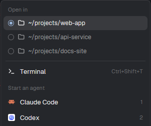
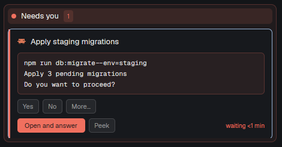
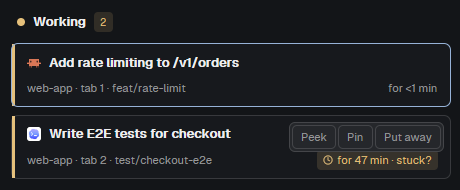
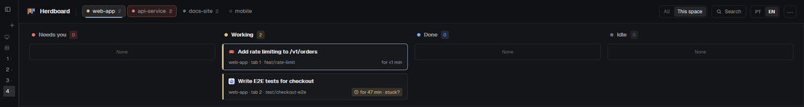
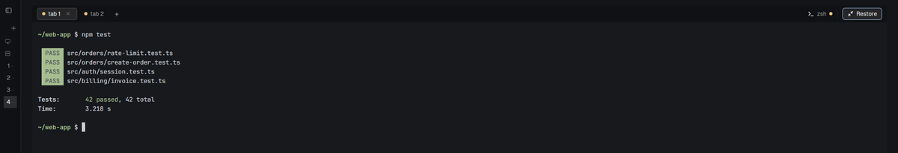
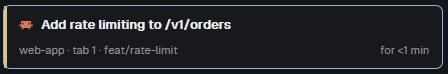

# Herdboard guide

[← Back to the README](../README.md) · [Português (Brasil)](guide.pt-BR.md)

## Using Herdboard

### Start an agent in the right project

1. Click **+** next to the tabs (or press `Ctrl+Shift+T`).
2. Under **Open in**, pick the project folder. The first one is where the active
   tab is now; the others are the folders of your other open terminals.
3. Pick **Terminal** or an agent (Claude Code, Codex, Gemini…). The new tab opens
   in that folder, in the current space.



*The **+** menu: pick the folder under **Open in**, then a terminal or an agent.*

Need a new project instead? **⋯ › New space** creates a space in the active tab's
folder; **+ › New space** creates it in the folder picked under **Open in**. Both
stay on the active space's machine.

### Cursor CLI sessions

Run `agent` in a terminal in your Herdr space. Herdboard recognizes the verified
Cursor installation's current foreground process, including when the terminal
originally started as a shell. No hook, wrapper or `programs.json` change is needed.
The verified launch forms are `agent` and `agent --yolo`; the latter is optional
and retains Cursor's own approval behavior. Other flags, subcommands, initial
prompts and Windows executable layouts are outside this discovery contract.

When Cursor has no usable reported status, its **Cursor CLI** card appears under
**Status unavailable**, with a neutral color and no status age or task inferred
from its screen. Click the card to open its terminal; hover for **Peek**, **Pin**
and **Put away**. All / This space and settled tabs work as for other cards.
The extra column appears only when needed; narrow windows show a labeled card in
the existing list. Header space counts include these sessions. Native agent
next/previous shortcuts still require a reported status in Herdr 0.1.14.

A current reported agent replaces the fallback card. If the report disappears,
the card returns to unavailable status; ending or replacing the Cursor process
removes it. Discovery does not read transcripts or provide Cursor activity text,
approval answers or in-process chat identity. See the
[verified versions, native checks and limits](issue-29-verification.md).

### Answer an agent that needs you

When an agent stops to ask something, its card jumps to **Needs you** and the column
turns red. If it's in another space, that space's pill in the header turns red too.



*Demo permission request in Herdr: the question, **Yes / No / More…**, **Open and
answer**, **Peek** and how long the agent has been waiting.*

1. Read the question right on the card: it shows the last lines of the agent's
   screen, without frames or separator lines (so a command between Claude Code's
   dashed rows shows), for example *"npm run db:migrate --env=staging · Apply 3
   pending migrations · Do you want to proceed?"*.
2. **Open and answer** focuses that agent's terminal, so you can type the answer.
   **Peek** opens it on top, without leaving the tab you're in.

**Yes / No for a permission dialog.** When the question is a Claude Code permission
dialog ("Do you want to proceed?") with options labelled exactly *Yes* and *No*, the
card also shows **Yes** and **No**. Each one presses that option's number in the
agent's terminal (no Enter), as you would; hover it to see the option's text. The
card then follows the agent's new status: it leaves **Needs you** once the agent
moves on. Before typing, the board checks that the agent is still blocked on the
same dialog: it reads the screen again and compares the whole request (every line of
the dialog, not just the part the card shows), and a button only answers the request
its card showed; if anything changed, it types nothing and reads the question again.
**More…**, next to Yes / No, lists the dialog's other numbered options (digits 1–9),
such as "Yes, and always allow…" or "Yes, and switch to auto mode". These can grant
more than one approval. The menu keeps the agent's own text, including wrapped lines;
hover a shortened item to read all of it. Choosing one runs the same check and presses
only its digit. The menu closes after a choice, on Escape or a press outside it, and
when the card leaves Needs you or gets a new request. After any answer all three
controls stay faded until the agent's status or request changes, so a second click
types nothing. More… appears only when Yes / No has other options to offer. For
other dialogs without a plain Yes / No pair, use **Open and answer**.

**Verified Codex command approval.** The complete local command dialog captured
with Codex CLI 0.167.0 on Linux also gets **Yes** / **No**, when Codex reports a
blocked permission request. **Yes** sends `y`, approving this command once.
**No** sends `esc`, canceling the request and interrupting the turn; type your
next instruction in the terminal. Neither adds Enter, and both work from every
captured selection. Tooltips show the original option and the cancellation effect.
Direct answers require the launch configuration recorded in the verification
notes; other launch settings retain the terminal fallback.
The persistent “don't ask again” choice has no card shortcut or **More…** entry;
use **Open and answer** for it. Other Codex dialogs, questions, remote environments
and incomplete screens keep **Open and answer** / **Peek**. If a resize changes the
request's wrapping, a click refreshes the card without sending keys; review it again.

The tested pi 0.85.1 `ui.confirm()` extension did not report a blocked agent to
Herdr, so it remains unsupported. New-agent startup/trust screens are unsupported.
See the [configurations, raw captures and observed outcomes](issue-4-verification.md)
for the exact verified coverage. Herdboard does not change approval policies or
install permission extensions.

**Workspace trust at startup.** The recognised Claude Code screen headed
"Accessing workspace:" also gets a card, even before Claude reports an agent status.
This includes narrow terminals where the explanation, folder path, options or
confirmation footer wrap across lines.
The card shows the folder: **Yes** chooses "Yes, I trust this folder"; **No** chooses
"No, exit". Each click moves from the selected row to that choice and confirms with
Enter, without a numbered shortcut. The tooltip names the actual choice. If the
folder, complete screen, cursor or Claude process changed, the click sends nothing.
Both answers stay disabled after one is sent. Only the complete recognised screen,
in a visible terminal running Claude in the foreground before its first status
report, qualifies; an unrelated terminal or menu does not get direct answer buttons.
Recognising a new trust request also brings a put-away tab back to the board and
the header count. Polling that same request does not undo a later **Put away**,
including after an answer fails validation.

In a narrow column, hover the shortened waiting time to read it in full.

If the question isn't on screen (for example, it scrolled away), the card says
*"Open the terminal to see what the agent is asking."*

### Keep an eye on many agents

- **All / This space** in the header: every agent, or only the active space's.
- **Pin** (hover a card): keeps an agent at the top of its column.
- **Put away** (hover a card): takes that tab off the board while it runs; it comes
  back by itself when an agent in it needs you.
- **"stuck?"**: a working card past 30 minutes gets this hint. Peek at it to see if
  it is still making progress.
- **Idle › fold**: folds the Idle column when you only care about active work.
- Click any card to jump to its space and tab; click a space pill to switch space.



*Hovering a card shows **Peek**, **Pin** and **Put away**; this one has been working
for 47 minutes, so it also shows **stuck?**.*



*With **This space** selected, the board shows only the agents of the active space
(here, `web-app`).*

### Focus on the terminal

**Expand** (right of the tabs) hides the header and the board, so the terminals
take the whole window; **Restore** brings them back. Tabs, **+** and **×** stay on
the rail while expanded.



*Expanded: the tab rail (with **Restore** on the right) and the terminal.*

### Reading a card



- **Left stripe**: the status color (here amber, Working).
- **Top line**: the agent's icon and its task title.
- **Doing now** (Working cards and compact entries): a recognized running tool
  label or live progress phase, in the agent's original words. Hover the activity
  for its full text. **Activity unavailable** means the screen, configuration or
  terminal could not establish current activity; it never substitutes the task title.
  [Captured Claude/Codex formats and pi limitation](issue-25-verification.md).
- **Bottom line**: space · tab · branch, and on the right how long it has been in
  this status.
- **Title**: what the agent named its task. After `/clear` the card shows
  **Last: …**, the last title Herdboard saw for that terminal.
- **Age**: how long it has been in this status (*waiting*, *for*, *finished … ago*).
- **Machine**: when Herdr has remote spaces, cards show the owning machine's name
  and identify agents on this computer as **Local**, even with **This space**
  selected. This also appears in compact entries and visible Idle rows. A board
  with only known local agents keeps its usual presentation. **Unknown machine**
  means the agent's owning space or machine information is unavailable; it does
  not mean Local. Hover the label to read the full machine name.
- Hover the card for the full title, place, program and terminal address.
- **Worktree**: the total pending Git files in this terminal's current worktree,
  including changes made by anyone. Staged and unstaged changes, conflicts and each
  untracked file count; ignored files do not. A file changed in both places counts
  once. A Git-recognized rename counts once; a move Git still reports as a deletion
  and a new file counts twice. Subdirectories show the whole worktree total.
  **0 files** means a successful clean query. **Unavailable** means the directory,
  machine or Git query could not be verified; it never means zero. Idle rows and
  the compact board show the same total. Hover the number for its meaning.

Machine ownership comes from each agent's own space, so identically named spaces
on different machines remain separate. It follows Herdr's existing live updates
without another machine query. [Verification](issue-27-verification.md) separates
the real scratch-local association, simulated mixed-machine coverage and private
native validation. Real remote connection details are not published.

### Back to your usual layout

**⋯ › Back to the default layout** switches to Herdr's own layout (a toast says how
to come back). `Ctrl+Shift+L` cycles layouts; **Settings › Look › Layout** lists
them all.

## Keys (while Herdboard shows)

| Key | Action |
| --- | --- |
| `Ctrl+Shift+T` | New tab menu (pick folder, terminal or agent) |
| `Ctrl+Shift+K` | Find a space or tab |
| `Ctrl+Shift+W` | Close the tab |
| `Ctrl+Shift+B` | Hide / show Herdr's sidebar |
| `Ctrl+Shift+L` | Switch layout |

## Good to know

- What runs besides drawing: the board runs `hc read <terminal> --lines 0`
  (Herdr's own CLI) each time an agent gets blocked, to read its question; if that
  read misses it (no question on screen yet or, for an eligible Claude/Codex permission
  dialog, no verified Yes / No), it reads up to two more times, 0.5 s later and then another
  1.5 s later, only while the agent stays blocked. It reads again when you click
  Yes / No or choose a More… option, and then sends that dialog's verified keys
  (`hc keys <terminal> <digit>` for Claude permissions, `y` or `esc` for Codex); the search
  runs `hc machine ls`, as Herdr's own search does; the new-tab menu asks Herdr which
  agents are installed. Startup discovery additionally reads eligible Claude terminals
  about once a second while the board shows; a startup answer checks `hc get` before
  and after its fresh screen read, then sends the arrows and Enter together.
  Codex answers also check `hc get` on both sides of that read to confirm the same
  process, working directory, launch configuration and blocked permission report.
  Git totals additionally run `git rev-parse --absolute-git-dir` and
  `git --no-optional-locks status --porcelain=v1 -z --untracked-files=all --ignored=no --renames`
  on the card's own machine and live directory. Git inspects the worktree; no file
  contents or diffs are shown. No mod downloads anything from the internet.
- Working activity adds visible-screen reads only from the cards instance, with
  at least **5 seconds after each completed read** and at most **2 activity reads
  in flight** across the board. Filters, Put away and hiding/expanding the board
  stop new activity reads. Pending reads keep their slot until they finish;
  failures use the same cooldown. Activity expires after **10 seconds**, and
  turn/process/status changes discard it immediately. Question/startup reads
  described above have their own schedules and are outside this activity ceiling.
- Git queries have a **10-second minimum interval** per equivalent query and at
  most **two physical commands** in flight, including discovery. Matching machine
  and directory discovery is shared; matching machine and canonical Git worktree
  status is shared even across subdirectories. Linked worktrees remain separate.
  Successful directory discovery is cached while visible cards consume it.
  Slow requests keep their slots until settlement; failures wait for the interval.
  There is no retry queue, and at most 128 recent query cooldowns are retained for
  one interval. Counts may wait longer when many different worktrees are shown.
  Only the board copy polls. Filtering, Put away, folded Idle rows and hiding or
  expanding the board stop queries without a visible consumer. Returning cards
  wait for a current result. Native execution measurements and simulated runtime
  checks are distinguished in [the verification record](issue-26-verification.md).
- The Peek window and Herdr's sidebar are Herdr's own and stay in English.
- Herdr can't change a space's registered folder after it's made; Herdboard always
  uses the terminals' live folders instead.
- Preferences live in Herdr's shared state under `herdboard.*`.

## FAQ

**A card says "No task title".** The agent hasn't named a task yet (for example, a
session where you only said hello). The title is the one the agent sets on its
terminal: in our tests, Claude Code set it once it started working on a task. From
then on, Herdboard keeps it even through `/clear`.

**A new tab opened in the wrong folder.** New tabs start where the active tab's
terminal *is*, not where the agent works: an agent started in `~/projects` that runs
`cd my-app && …` inside its commands is still in `~/projects`. Pick the project under
**Open in** on the **+** menu, or start agents from that menu so they begin in the
project folder.

**The time on a card looks wrong.** Herdr records times per tab. When a tab has more
than one agent, Herdboard counts from when it first saw each one's status instead.

**Can I change the 30-minute "stuck?" limit?** Yes: `STUCK_MIN` at the top of
`mods/herdboard/main.js`, then run `scripts/install.sh` again.

**Does it work with light themes?** Yes. Every color comes from your Herdr theme.

## Update

```sh
herdboard/scripts/update.sh
```

It fast-forwards your clone (`git pull --ff-only`) and runs `scripts/install.sh`
again. Herdr reloads the layout and mods by itself; no restart needed. To see which
files an install would overwrite, run `scripts/install.sh --dry-run`: it lists each file
as **new**, **overwrite** or **unchanged**, says what would happen to `keys.json`, and
changes nothing.

If you edited a file in the clone (`STUCK_MIN`, say), the update stops before
pulling and lists what you changed. To keep your edits, run this inside the clone:

```sh
git stash && scripts/update.sh && git stash pop && scripts/install.sh
```

If it stops partway, your edits stay stashed; `git stash pop` brings them back. If
you'd rather commit your edits, the update can't fast-forward once Herdboard has new
commits too: run `git pull --rebase && scripts/install.sh` instead. The update also
stops, without installing, whenever your branch can't fast-forward (your commits and
new Herdboard commits both, or it isn't tracking a remote branch), and says so.

## Uninstall

```sh
herdboard/scripts/uninstall.sh
```

It finds your Herdr home the way the install does and removes `layouts/herdboard.json`,
the `mods/herdboard`, `mods/herdboard-picker` and `mods/herdboard-new-menu` folders,
and the `"layout:herdboard"` section of `keys.json`, backing `keys.json` up first to
`keys.json.before-herdboard-uninstall` (if that section was all it had, `keys.json` is
deleted). Your other layouts, mods and keys are untouched. Parts already gone are
skipped, so running it twice is safe. If Herdboard was your active layout, switch to
another one in Herdr (**Settings › Look › Layout**) or with `Ctrl+Shift+L`.

To see first what it would remove, run `scripts/uninstall.sh --dry-run`: it lists each
file, folder and `keys.json` change, and changes nothing.
