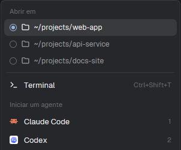
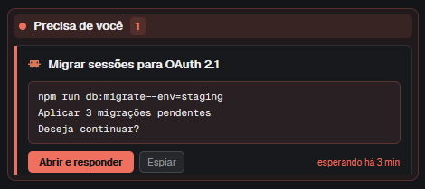
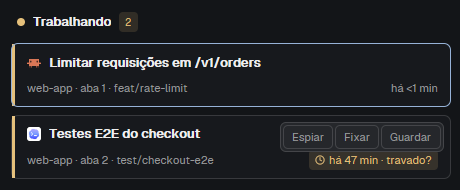
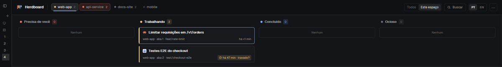
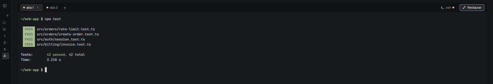
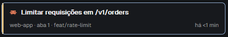

# Guia do Herdboard

[← Voltar ao README](../README.pt-BR.md) · [English](guide.md)

## Como usar

### Iniciar um agente no projeto certo

1. Clique no **+** ao lado das abas (ou aperte `Ctrl+Shift+T`).
2. Em **Abrir em**, escolha a pasta do projeto. A primeira é onde a aba ativa está
   agora; as outras são as pastas dos seus outros terminais abertos.
3. Escolha **Terminal** ou um agente (Claude Code, Codex, Gemini…). A nova aba abre
   nessa pasta, no espaço atual.



*O menu do **+**: escolha a pasta em **Abrir em** e depois um terminal ou um agente.*

Precisa de um projeto novo? **⋯ › Novo espaço** cria um espaço na pasta da aba
ativa; **+ › Novo espaço** cria na pasta escolhida em **Abrir em**. Os dois ficam na
mesma máquina do espaço ativo.

### Responder um agente que precisa de você

Quando um agente para e pergunta algo, o card dele vai para **Precisa de você** e a
coluna fica vermelha. Se ele estiver em outro espaço, esse espaço também fica vermelho
no cabeçalho.



*Um agente bloqueado: a pergunta dele, **Abrir e responder**, **Espiar** e há quanto
tempo ele está esperando.*

1. Leia a pergunta no próprio card: ele mostra as últimas linhas da tela do agente,
   sem molduras nem linhas separadoras (assim aparece o comando entre as linhas
   tracejadas do Claude Code), por exemplo *"npm run db:migrate --env=staging ·
   Aplicar 3 migrações pendentes · Deseja continuar?"*.
2. **Abrir e responder** foca o terminal desse agente para você digitar a resposta.
   **Espiar** abre o terminal por cima, sem sair da aba em que você está.

**Sim / Não num pedido de permissão.** Quando a pergunta é um pedido de permissão do
Claude Code ("Do you want to proceed?") com opções escritas exatamente *Yes* e *No*,
o card também mostra **Sim** e **Não**. Cada um aperta o número dessa opção no
terminal do agente (sem Enter), como você faria; passe o mouse para ver o texto da
opção. O card então acompanha o novo status do agente: sai de **Precisa de você**
quando o agente segue. Antes de digitar, o quadro confere se o agente continua
bloqueado no mesmo pedido: lê a tela de novo e compara o pedido inteiro (todas as
linhas do diálogo, não só o trecho que o card mostra), e um botão só responde ao
pedido que o card dele mostrou; se algo mudou, não digita nada e lê a pergunta outra
vez. Depois de uma resposta, os botões ficam apagados até o status
do agente mudar, então um segundo clique não digita nada. Outras escolhas ("Yes, and
always allow…") e pedidos sem um par Yes / No simples: use **Abrir e responder**.

Se a pergunta não estiver na tela (por exemplo, rolou para cima), o card diz
*"Abra o terminal para ver o que o agente pede."*

### Acompanhar muitos agentes

- **Todos / Este espaço** no cabeçalho: todos os agentes, ou só os do espaço ativo.
- **Fixar** (passe o mouse no card): mantém o agente no topo da coluna.
- **Guardar** (passe o mouse no card): tira a aba do quadro enquanto ela roda; ela
  volta sozinha quando um agente nela precisar de você.
- **"travado?"**: um card trabalhando há mais de 30 minutos ganha esse aviso. Espie
  para ver se ele ainda está avançando.
- **Ocioso › recolher**: recolhe a coluna Ocioso quando você só quer ver o trabalho
  ativo.
- Clique em qualquer card para ir ao espaço e à aba dele; clique num espaço do
  cabeçalho para trocar de espaço.



*Com o mouse sobre um card aparecem **Espiar**, **Fixar** e **Guardar**; este está
trabalhando há 47 minutos, por isso também mostra **travado?**.*



*Com **Este espaço** selecionado, o quadro mostra só os agentes do espaço ativo
(aqui, `web-app`).*

### Focar no terminal

**Expandir** (à direita das abas) esconde o cabeçalho e o quadro, e os terminais
ocupam a janela toda; **Restaurar** traz tudo de volta. As abas, o **+** e o **×**
continuam na barra enquanto está expandido.



*Expandido: a barra de abas (com **Restaurar** à direita) e o terminal.*

### Como ler um card



- **Faixa à esquerda**: a cor do status (aqui âmbar, Trabalhando).
- **Linha de cima**: o ícone do agente e o título da tarefa.
- **Linha de baixo**: espaço · aba · branch e, à direita, há quanto tempo ele está
  nesse status.
- **Título**: o nome que o agente deu à tarefa. Depois de um `/clear`, o card mostra
  **Última: …**, o último título que o Herdboard viu naquele terminal.
- **Tempo**: há quanto tempo ele está nesse status (*esperando há*, *há*, *concluiu
  há*).
- Passe o mouse no card para ver o título completo, o local, o programa e o endereço
  do terminal.

### Voltar ao layout de sempre

**⋯ › Voltar ao layout padrão** troca para o layout do próprio Herdr (um aviso
explica como voltar). `Ctrl+Shift+L` alterna os layouts; **Settings › Look ›
Layout** lista todos.

## Atalhos (com o Herdboard aberto)

| Tecla | Ação |
| --- | --- |
| `Ctrl+Shift+T` | Menu de nova aba (escolher pasta, terminal ou agente) |
| `Ctrl+Shift+K` | Buscar espaço ou aba |
| `Ctrl+Shift+W` | Fechar a aba |
| `Ctrl+Shift+B` | Mostrar / ocultar a barra lateral do Herdr |
| `Ctrl+Shift+L` | Trocar de layout |

## Bom saber

- O que roda além do desenho: o quadro executa `hc read <terminal> --lines 0` (a
  linha de comando do próprio Herdr) a cada bloqueio, para ler a pergunta do agente;
  se essa leitura não a encontrar (a pergunta ainda não está na tela ou, num pedido
  de permissão do Claude Code, falta o Sim / Não), lê até mais duas vezes, 0,5 s
  depois e, de novo, 1,5 s depois disso, só enquanto o agente continuar bloqueado.
  Lê de novo quando você clica em Sim / Não, e então executa `hc keys <terminal>
  <dígito>`; a busca executa `hc machine ls`, como a busca original do Herdr; o menu de
  nova aba pergunta ao Herdr quais agentes estão instalados. Nenhum mod baixa nada
  da internet nem lê seus arquivos.
- A janela do Espiar e a barra lateral são do próprio Herdr e ficam em inglês.
- O Herdr não permite mudar a pasta registrada de um espaço depois de criado; o
  Herdboard sempre usa a pasta atual dos terminais.
- As preferências ficam no estado compartilhado do Herdr, em `herdboard.*`.

## Perguntas frequentes

**O card diz "Sem título da tarefa".** O agente ainda não deu nome a uma tarefa
(por exemplo, numa sessão em que você só disse "olá"). O título é o que o agente
define no terminal dele: nos nossos testes, o Claude Code o definiu quando começou a
trabalhar numa tarefa. A partir daí, o Herdboard guarda o título mesmo depois de um
`/clear`.

**A nova aba abriu na pasta errada.** Novas abas começam onde o terminal da aba
ativa *está*, não onde o agente trabalha: um agente iniciado em `~/projetos` que roda
`cd meu-app && …` dentro dos comandos continua em `~/projetos`. Escolha o projeto em
**Abrir em**, no menu do **+**, ou inicie os agentes por esse menu para que eles já
comecem na pasta do projeto.

**O tempo de um card parece errado.** O Herdr registra os tempos por aba. Quando uma
aba tem mais de um agente, o Herdboard conta a partir de quando viu o status de cada
um.

**Dá para mudar o limite de 30 minutos do "travado?"?** Sim: `STUCK_MIN` no início
de `mods/herdboard/main.js`; depois rode `scripts/install.sh` de novo.

**Funciona com temas claros?** Sim. Todas as cores vêm do tema do seu Herdr.

## Atualizar

```sh
herdboard/scripts/update.sh
```

Ele avança o seu clone (`git pull --ff-only`) e roda `scripts/install.sh` de novo.
O Herdr recarrega o layout e os mods sozinho; não precisa reiniciar. Para ver quais
arquivos uma instalação sobrescreveria, rode `scripts/install.sh --dry-run`: ele lista
cada arquivo como **new** (novo), **overwrite** (sobrescreve) ou **unchanged** (igual),
diz o que aconteceria com o `keys.json` e não muda nada.

Se você editou algum arquivo do clone (o `STUCK_MIN`, por exemplo), a atualização
para antes do pull e lista o que você mudou. Para manter as suas edições, rode
dentro do clone:

```sh
git stash && scripts/update.sh && git stash pop && scripts/install.sh
```

Se parar no meio, as suas edições continuam guardadas no stash; `git stash pop` as
traz de volta. Se preferir fazer commit delas, a atualização não consegue mais
avançar direto: rode `git pull --rebase && scripts/install.sh` no lugar dela. A
atualização também para, sem instalar, sempre que o seu branch não pode avançar
direto (ele tem commits seus, ou não acompanha nenhum branch remoto), e avisa.

## Desinstalar

```sh
herdboard/scripts/uninstall.sh
```

Ele encontra a pasta do Herdr do mesmo jeito que a instalação e remove
`layouts/herdboard.json`, as pastas `mods/herdboard`, `mods/herdboard-picker` e
`mods/herdboard-new-menu` e a seção `"layout:herdboard"` do `keys.json`, fazendo antes
um backup do `keys.json` em `keys.json.before-herdboard-uninstall` (se essa seção era
tudo o que ele tinha, o `keys.json` é apagado). Seus outros layouts, mods e atalhos não
mudam. O que já não existe é pulado, então rodar duas vezes não faz mal. Se o Herdboard
era o seu layout ativo, troque para outro no Herdr (**Settings › Look › Layout**) ou
com `Ctrl+Shift+L`.

Para ver antes o que seria removido, rode `scripts/uninstall.sh --dry-run`: ele lista
cada arquivo, pasta e mudança no `keys.json`, e não muda nada.
